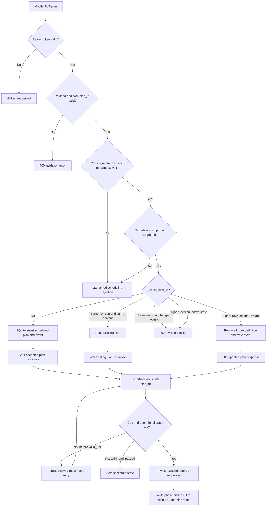
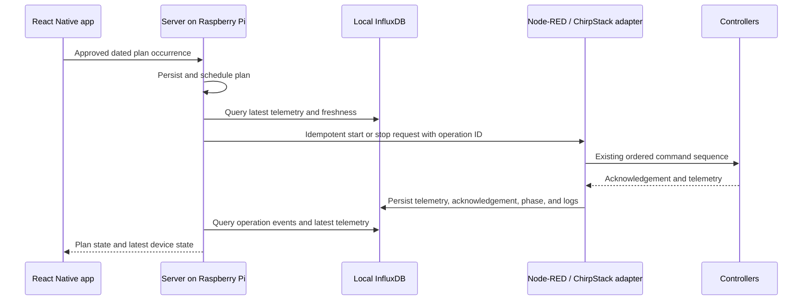

# AI watering-plan roadmap

## Purpose

This document is the shared implementation contract for the first watering-plan
layer. It lets a mobile application submit already-approved human or AI plans
to the Raspberry Pi. Node-RED persists the plans, waits for the requested time,
uses the existing Integrated Dashboard sequencer to execute them, and records
the result.

This is an interim, serverless deployment: Node-RED runs on the Raspberry Pi
and is the plan receiver and executor. A future local server will take over the
same persistence and API contract without changing device commands or the
mobile plan payload.

## Confirmed decisions

- The mobile application creates both human and AI plans. AI approval happens
  in the mobile application when the user saves the proposal; Node-RED does not
  run an approval workflow.
- Node-RED receives only an approved plan, stores it, and controls the hardware
  through the existing sequencer.
- One plan can target one field, selected fields, or all configured fields.
  Selected target valves start in parallel if the pump has enough capacity.
- A due plan that cannot start is delayed. It must never start after its allowed
  delay window has expired.
- The system has one pump and only one active pump run at a time. A later due
  plan remains delayed until that run completes or expires.
- The field user decides when and how to water. Crop, growth-stage, weather,
  and AI input data belong to mobile or future-server records and are not
  required for hardware execution.
- Version 1 supports duration plans and flow-volume plans for one,
  commissioned metered valve. It does not use soil moisture as a stop rule:
  field/sensor mapping, deployed sampling cadence, and multi-field semantics
  are not commissioned yet. A multi-field plan initially uses duration as its
  stop rule. A group volume target is not meaningful until every participating
  field has proven metering, or a shared-meter allocation policy exists.
- Device controllers retain physical safety authority. Node-RED still owns
  scheduling, conflict avoidance, idempotency, command sequencing, and
  execution observability.
- The first mobile test path is a direct Raspberry Pi connection on the local
  Wi-Fi/LAN. Remote and global access will arrive later through server code;
  the Raspberry Pi must not be exposed directly to the public Internet.
- Until the mobile design exposes a user-selected delay window, it sends a
  static `valid_until` value of ten hours after `start_at`. The payload retains
  the field so a later mobile release can make it user-selectable without
  changing Node-RED.
- Cancelling a running plan requests the existing ordered stop sequence. A
  cancellation acknowledgement means `stop requested`; it is not a claim that
  the physical pump and valves have already stopped.
- `all fields` is resolved to a fixed valve snapshot when Node-RED accepts a
  plan. Adding a new valve later cannot change an already approved plan.
- SQLite is approved for the Raspberry Pi prototype plan store.
- The mobile application is planned in React Native. It owns plan authoring,
  AI presentation, recurrence expansion, local retries, and the field/crop
  records needed for its user experience.
- The initial prototype registry uses logical field id `field-001`, mapped to
  `valve1`, as the commissioned flow-meter field. The name is intentionally a
  stable integration id rather than a crop or location name.
- Prototype API pairing uses a short-lived QR code to provision a long random
  token into the mobile app's secure storage.
- The Raspberry Pi must have a synchronized clock before starting a due plan;
  while unsynchronized, due plans remain delayed with a named clock reason.
- On restart during an active run, recovery may attempt only the existing safe
  stop path after fresh telemetry. If the stop outcome is uncertain, the plan
  enters `recovery_required`; watering is never resumed or restarted
  automatically.
- A newer revision may replace only a `scheduled` or `delayed` plan. An active
  plan must be cancelled before its target or stop rule can change.
- `valve1` and `valve2` may be opened together for a controlled stress test.
  Any manually simulated flow for `valve2` is test-only evidence and must be
  labelled `simulated_meter`; it must never make `valve2` a production-capable
  volume-plan target.

## Boundary with the existing sequencer

The current Integrated Dashboard owns the ordered sequence: validate the run,
open MainValve, open selected field valves, configure/start the pump, monitor,
stop the pump, close field valves, then close MainValve. The schedule layer
must invoke that single executor and observe its state. It must not create a
second direct pump/valve command path.

The current dashboard also has operational freshness and acknowledgement gates.
They remain necessary even though device controllers enforce physical safety:
they prevent a schedule from treating an unconfirmed LoRaWAN command as an
executed action.

## Plan payload received from mobile

The future local server and the temporary Node-RED endpoint share this logical
request. All timestamps are ISO 8601 with an explicit offset. The user-facing
timezone must be retained even if the server stores UTC internally.

```json
{
  "schema_version": 1,
  "plan_id": "mobile-generated-unique-id",
  "revision": 1,
  "status": "scheduled",
  "source": "ai",
  "plan_group_id": "mobile-ai-recommendation-2026-09-24-30",
  "summary": "Optional short human or AI explanation",
  "created_at": "2026-10-09T10:00:00+05:00",
  "timezone": "Asia/Tashkent",
  "start_at": "2026-10-10T06:00:00+05:00",
  "valid_until": "2026-10-10T16:00:00+05:00",
  "targets": {
    "mode": "selected",
    "field_ids": ["field-001"]
  },
  "run_mode": "parallel",
  "stop": {
    "type": "volume",
    "value": 40,
    "unit": "m3"
  },
  "hard_max_runtime_sec": 10800
}
```

The values above are examples, not deployed limits. Device-specific capability
validation decides whether a plan can be accepted; it must not silently change
the request.

For the prototype mobile client, `valid_until` is generated as `start_at + 10
hours`. This value is configuration and must be sent explicitly with every
plan, not recreated from a hidden gateway default.

### Required external fields

| Field | Meaning |
|---|---|
| `schema_version` | Payload compatibility version. |
| `plan_id` | Immutable mobile-generated idempotency key. |
| `revision` | Monotonically increasing version of the plan. |
| `status` | Mobile request: `scheduled` or `cancelled`. |
| `source` | `human` or `ai`, retained for display and audit. |
| `plan_group_id` | Optional mobile-owned identifier linking dated occurrences created from one recurring or AI recommendation. It is not a gateway scheduling rule. |
| `summary` | Optional compact rationale; not an execution rule. |
| `created_at` | Mobile audit time. |
| `timezone` | IANA zone used for calendar presentation, for example `Asia/Tashkent`. |
| `start_at` | Intended start time. |
| `valid_until` | End of the permitted delay window. |
| `targets` | Explicit field selection; `all` is resolved to an explicit field/valve snapshot when accepted. |
| `run_mode` | `parallel` in version 1. |
| `stop` | Requested duration or volume target. `moisture` is reserved for a later schema revision. |
| `hard_max_runtime_sec` | Mandatory upper execution bound. |

### Capability rules for version 1

| Stop type | Supported targets | Condition |
|---|---|---|
| `duration` | One or more valves | The plan starts the selected valves in parallel. |
| `volume` | One metered valve only | Meter health, fresh flow data, and the commissioned volume decoder are required. |
| `moisture` | Not supported in version 1 | Add only after the field/sensor mapping, sampling cadence, and stop semantics are commissioned. |

An unsupported payload is rejected with a named reason before it becomes due.

### Acceptance, revision, and cancellation rules

The gateway must validate a plan before inserting it. At minimum it verifies:

- authenticated request, supported schema version, non-empty plan id, and a
  positive revision;
- `start_at < valid_until`, explicit timestamp offsets, and a positive hard
  runtime limit;
- one or more known target valves after resolving an `all` snapshot;
- no duplicate target valve ids;
- a stop type/unit/value combination supported by the resolved target set;
- the configured maximum parallel-valve limit; and
- the gateway's independently configured maximum run duration; and
- a plan is not already in an irreversible execution state.

`hard_max_runtime_sec` is a request-side limit, never permission to exceed the
gateway limit. The accepted hard limit is the lower of the requested value and
the independently configured gateway maximum. The current dashboard has a
four-hour source setting, but a field deployment value must be deliberately
commissioned rather than inferred from this document.

`plan_id` is the idempotency key. The behavior is fixed:

| Incoming request | Result |
|---|---|
| New `plan_id` | Validate and insert as `scheduled`. |
| Same revision and same canonical payload | Return the existing plan; mobile retry is safe. |
| Same revision with changed content | Reject as a conflict. |
| Lower revision | Reject as stale. |
| Higher revision for `scheduled` or `delayed` | Replace the definition, create an event, and retain history. |
| Higher revision for `starting`, `running`, or `stopping` | Reject; mobile cancels the active run first. |
| Cancellation of a future plan | Mark `cancelled`; it must never become due. |
| Cancellation of an active plan | Mark `stop_requested` and enter the existing ordered stop path. |

Version 1 does not receive recurrence rules. The React Native app expands each
recurring intention or confirmed multi-date AI recommendation into distinct
dated plan occurrences, each with its own `plan_id`. An optional
`plan_group_id` lets the client reconnect those occurrences for its calendar
and "3 schedules saved" presentation. This keeps the Raspberry Pi scheduler
deterministic and lets users cancel one occurrence without changing future
ones.

## Field registry and target resolution

The plan uses stable logical IDs, never ChirpStack DevEUIs or Node-RED node ids.
The Raspberry Pi stores a field registry that maps a mobile field to current
hardware capability. The complete map-facing field catalog is documented in
`../mobile/FARM_SPATIAL_DATA_MODEL.md`; the scheduler reads only the operational
mapping it needs. A minimal execution record contains:

```json
{
  "field_id": "field-001",
  "display_name": "Field 1",
  "valve_id": "valve1",
  "flow_meter": "commissioned",
  "soil_sensor_id": null,
  "enabled": true
}
```

The example is a schema shape, not the actual site mapping. The registry is the
only place that translates logical field IDs into the existing dashboard's
`valve1`/`valve2` keys. `targets.mode = all` resolves enabled registry entries
when the plan is accepted and stores the resulting valve list with that plan.

## Scheduler rules

- The existing five-second dashboard cadence is sufficient for schedule checks;
  the persistent store claim must ensure that only one tick can own a due plan.
- A plan becomes eligible at `start_at`. If another run is active or the
  executor reports an operational gate failure, it becomes `delayed` with a
  reason and is checked again on later ticks.
- When several eligible plans compete for an idle pump, version 1 uses earliest
  `start_at`, then gateway acceptance time, then `plan_id` as a stable tie-break.
  There is no hidden priority field.
- A duration run stops when its persisted elapsed time reaches the target. A
  volume run captures the commissioned positive-total baseline before start and
  stops when the delta reaches the requested target. Loss of required meter
  evidence ends the run through the existing stop path and records failure.
- The scheduler never infers physical field-valve position from a successful
  latching-solenoid command. It follows the executor's acknowledgement rules
  and reports their limitation.
- A plan may be delayed but never silently modified, merged with another plan,
  or started after `valid_until`.

## Parallel-valve capacity

Parallel-valve capacity is the gateway rule that answers: *may this exact set
of field valves be opened together behind one pump?* It is not pressure control
and it does not estimate pump capacity from live telemetry. Without this rule,
a mobile request for `all fields` could open more hydraulic demand than the pump
or pipeline can support.

The gateway uses an operator-commissioned allow-list of valve sets. A plan is
accepted only when its resolved target set is in that allow-list. This is more
accurate than a simple maximum count: two large fields can require more water
than several small fields.

For the prototype, `["valve1", "valve2"]` is allowed only for controlled
stress testing. It demonstrates scheduler concurrency and the existing shared
pump sequence; it is not production hydraulic commissioning. Production
allow-lists for up to fifteen future fields are added only after the actual
pump, pipe network, and each field's required pressure/flow have been tested.

## Internal state and result records

Node-RED or the later server stores execution fields separately from the mobile
definition. A recurring mobile plan is sent as individual executable
occurrences in version 1; recurrence expansion remains the responsibility of
the mobile app.

```
scheduled -> delayed -> starting -> running -> stopping -> completed
     |          |          |           |            |
     +-> cancelled          +-> failed              +-> failed
     +-> expired
```

- `scheduled`: accepted and waiting for `start_at`.
- `delayed`: due but busy or unable to pass the executor's operational gates.
- `starting`: claimed by one scheduler instance and handed to the sequencer.
- `running` / `stopping`: mirrored from the sequencer.
- `completed`: normal target, manual stop, or another reported completion reason.
- `failed`: a sequence fault or an unresolved teardown outcome.
- `expired`: `valid_until` passed before a safe start.
- `cancelled`: mobile cancelled a future plan, or requested stop for an active one.

Each attempt records: accepted revision, resolved valve snapshot, state-change
times, dashboard phase/notice, device command identifiers, requested target,
actual start/end, actual delivered volume where available, relevant moisture
readings, and final stop/failure reason. Telemetry and append-only event logs
continue to go to InfluxDB.

## Persistence and local interfaces

InfluxDB remains the telemetry and immutable event-log database. It is not the
authoritative schedule store because a schedule must be replaced, cancelled,
claimed once, and reconciled after restart.

The preferred temporary store is a small SQLite database on the Raspberry Pi,
accessed from Node-RED. It needs tables for plans, execution attempts, and an
append-only plan-event log. If the required SQLite Node-RED module cannot be
installed, use Node-RED `localfilesystem` context only as a short-lived
prototype; it is a fallback, not the deployment design.

The initial local API should be versioned and kept deliberately small:

| Method | Path | Purpose |
|---|---|---|
| `GET` | `/api/v1/health` | Return API version, Pi time, and clock-sync state. |
| `GET` | `/api/v1/device-state` | Return an InfluxDB-derived current device snapshot with observation times. |
| `PUT` | `/api/v1/watering-plans/{plan_id}` | Create or replace a newer mobile revision. |
| `POST` | `/api/v1/watering-plans/{plan_id}/cancel` | Cancel a future plan or request active-plan stop. |
| `GET` | `/api/v1/watering-plans` | Show current and upcoming plans. |
| `GET` | `/api/v1/watering-plans/{plan_id}` | Return plan, result, and state history. |

The transport between the mobile app and Raspberry Pi has not yet been selected.
For the prototype, it is a local Wi-Fi/LAN HTTP API. The local API still needs
an authentication token and must not expose the Node-RED editor/admin endpoint.
The later remote design uses an outbound Raspberry Pi connection to server code
or a VPN; it must not require inbound public access to the Raspberry Pi.

## Temporary direct-mobile Node-RED API

Until the local server exists, the React Native test app talks directly to a
small Node-RED HTTP API over the site Wi-Fi. This is a temporary replacement
for the server's plan endpoint, not an attempt to make Node-RED the mobile
backend. It accepts only user-approved executable occurrences; AI drafting,
approval, map data, recurrence UI, and plan authoring remain in the app.

```mermaid
sequenceDiagram
    participant M as React Native test app
    participant N as Node-RED plan API on Pi
    participant Q as SQLite plan store
    participant I as Local InfluxDB
    participant C as Existing command sequencer
    M->>N: Bearer-authenticated PUT plan
    N->>N: Validate schema, time window, and capabilities
    N->>Q: Insert or idempotently resolve revision
    N-->>M: Accepted plan state
    N->>Q: Scheduler claims due plan
    N->>C: Request existing ordered sequence
    C->>I: Write telemetry, acknowledgement, and result events
    M->>N: GET plan / cancel request
    N->>Q: Read or update plan state
    N-->>M: Plan state; result fields when available
```

### Temporary API contract

The API uses the versioned plan paths already listed above. It adds one small
read-only endpoint for setup and diagnostics:

| Method | Path | Temporary behavior |
|---|---|---|
| `GET` | `/api/v1/health` | Returns API version, Pi time, clock-sync state, and no device secrets. |
| `GET` | `/api/v1/device-state` | Queries InfluxDB and returns the latest normalized pump, valve, and field-state snapshot. |
| `PUT` | `/api/v1/watering-plans/{plan_id}` | Validates and accepts one approved plan occurrence. Repeating identical content is safe. |
| `POST` | `/api/v1/watering-plans/{plan_id}/cancel` | Cancels a future plan or records `stop_requested` for an active plan. |
| `GET` | `/api/v1/watering-plans` | Returns plan records and their current scheduler state. |
| `GET` | `/api/v1/watering-plans/{plan_id}` | Returns one plan and its execution fields recorded so far. |

### Temporary API action diagram



### Compatibility rule: one mobile API contract

The temporary Node-RED API and the later server API implement the same `/api/v1`
contract. They must keep the same paths, request fields, response fields,
status codes, state names, pagination/order semantics, and idempotency rules.
The server may add later API versions, but it must not silently change version
1.

For `GET /api/v1/watering-plans`, both implementations accept optional `from`,
`to`, `limit`, and opaque `cursor` query fields. They return ascending
`start_at`, then `plan_id`, with `next_cursor` or `null`. The exact mobile
record shape is maintained in
[`../mobile/REACT_NATIVE_WATERING_PLAN_INTEGRATION.md`](../mobile/REACT_NATIVE_WATERING_PLAN_INTEGRATION.md).

The mobile app does not branch its watering-plan business logic by backend.
It has one configurable connection profile:

| Setting | Temporary test profile | Production profile |
|---|---|---|
| `baseUrl` | Pi LAN URL for Node-RED API | Server URL, initially the same Pi's local-server URL |
| Bearer credential | Prototype pairing token | Server-issued access token |
| API version | `/api/v1` | `/api/v1` |
| Requests, payloads, responses | Identical | Identical |

Only the connection-profile selection is switchable. It belongs in one mobile
configuration module or build setting, not in schedule screens, plan models, or
retry logic. After production cutover, the temporary profile can be removed
without changing those app features.

Every successful response uses this envelope:

```json
{
  "api_version": "v1",
  "request_id": "server-or-node-red-generated-id",
  "data": {}
}
```

Every error uses the same envelope and never exposes device secrets:

```json
{
  "api_version": "v1",
  "request_id": "server-or-node-red-generated-id",
  "error": {
    "code": "unsupported_volume_target",
    "message": "Volume plans require one commissioned metered valve.",
    "details": []
  }
}
```

Use these HTTP status meanings in both implementations: `200` read, repeated
idempotent write, or accepted replacement; `201` new plan; `202` active-plan
stop requested; `400` malformed request; `401` missing/invalid credential;
`404` unknown plan; `409` revision conflict or active-plan replacement attempt;
`422` valid JSON that violates a named plan/capability/time rule; and `500` an
unexpected internal failure. A client must display the named error code or
translate it, rather than treating it as a successful plan.

`GET /api/v1/device-state` is pull-only in version 1. Its `data` contains a
server/Node-RED aggregation of the most recent InfluxDB records, an overall
`generated_at` time, and an `observed_at` time for each device or field. It
must explicitly mark stale/unavailable records. Neither implementation uses
WebSockets, server-sent events, or a push notification as a source of live
device control state in version 1.

The app retries a request only with the same `plan_id` and `revision`. A
successful API response means the plan was stored and validated for scheduling;
it never means watering has started. The app reads later plan state to learn
whether the plan is delayed, running, completed, expired, or failed.

### Temporary LAN access and token handling

1. The installer places the Pi and test phone on the same private Wi-Fi.
2. The installer opens a temporary Node-RED dashboard setup page and displays
   a QR code containing the Pi's LAN base URL and a randomly generated,
   prototype-only API token.
3. The React Native app scans the code and stores the URL and token in platform
   secure storage. It sends the token as `Authorization: Bearer <token>`.
4. Node-RED validates the token before parsing or writing any plan. Rate-limit
   failed attempts and log only token fingerprints, never the token itself.
5. The Node-RED editor and admin endpoints use separate administrator
   credentials and are not linked from, or shared with, the mobile app. A
   firewall or reverse proxy exposes only the required dashboard and
   `/api/v1/*` routes to the test Wi-Fi, never the editor/admin routes.

The first test may use HTTP only on an isolated private LAN, but bearer tokens
are visible to any network observer on HTTP. Use HTTPS through a local reverse
proxy as soon as the test network is not fully trusted. Remote access waits for
the server; do not port-forward Node-RED.

The token mechanism is intentionally disposable. The future server replaces it
with user authentication, device pairing, and token rotation while keeping the
same plan payload and idempotency fields.

## Temporary API and future-server responsibility boundary

The temporary API is a Node-RED HTTP endpoint on the Raspberry Pi. It proves
local scheduling before the server exists. It is deliberately narrow: approved
executable plans in, plan state and results out.

The future server also runs on that Raspberry Pi. It becomes the single
mobile-facing API and the owner of plan lifecycle: it stores approved plans,
decides when they are due, handles delay/expiry/conflicts/cancellation, and
serves the integrated half-manual dashboard. Node-RED remains a local device
adapter: it receives a server request, performs the existing ordered sequence
through ChirpStack, and writes acknowledgements and results to InfluxDB.

| Responsibility | Temporary Node-RED API | Server on the Raspberry Pi | Node-RED after server adoption |
|---|---|---|---|
| Mobile entry point | Local Wi-Fi HTTP. | Authenticated local API, then remote access through the server. | No mobile endpoint. |
| Identity and access | Site pairing token only. | Users, farms, roles, device pairing, token lifecycle, and audit access. | Accept requests only from the local server. |
| AI proposal | Receives only an approved result. | Not required: AI proposal and approval may stay entirely in the mobile app. | Receives only an approved executable occurrence. |
| Field, crop, map, GPS and weather data | Outside scope. | Canonical product records and map-facing data when the product needs them. | Minimal field-to-device capability configuration. |
| Recurrence and AI multi-date grouping | Receives expanded occurrences. | Stores `plan_group_id` and occurrences. Mobile keeps expanding recurrence until this is deliberately changed in a versioned contract. | Receives one dated occurrence to run or cancel. |
| Plan persistence | SQLite owns plans for the temporary deployment. | SQLite owns plan definitions and operational state transitions needed by the scheduler. | Keeps only command/sequence state needed for recovery. |
| Scheduler and conflicts | Owns due-time scheduling and one-pump conflict checks. | Owns due-time scheduling, delay, expiry, and one-pump conflict checks. | Reports current availability and rejects an unsafe/invalid launch. |
| Hardware command path | Calls the existing Integrated Dashboard sequencer. | Sends idempotent `start`/`stop` requests to a local command endpoint. | Calls the existing sequencer; no direct mobile command path. |
| Execution result | Returns local status to mobile. | Reads plan/device outcome from SQLite and InfluxDB, then exposes it through its API. | Writes command acknowledgement, phase, telemetry-derived result, and failure reason to InfluxDB. |

There are three different kinds of authority. The server has **plan authority**:
it changes plan states and decides whether to request a run. Node-RED has
**command-sequence ownership**: only it performs the established MainValve →
field valves → pump sequence and its reverse stop sequence. Device controllers
retain **physical safety authority**: they enforce their local limits even if a
server or Node-RED process is wrong. This division gives the server the broad
management role you expect without duplicating a tested hardware command path.

### Local telemetry path

The server may read local InfluxDB rather than subscribe to Mosquitto. This is
a good fit for the first server because Influx already contains normalized
device telemetry, logs, and historical context. The server queries the latest
point for each device and treats its measurement timestamp as the freshness
clock; it must not treat a successful database query as fresh telemetry.

For an attempted start or an active run, the server reads the relevant
command/sequence events from InfluxDB too. A local Node-RED command endpoint
accepts an idempotent request carrying a server-generated operation ID, but it
is not a device-data feed. Node-RED writes its acknowledgement and subsequent
phase changes to InfluxDB under that operation ID. The server marks the plan
`dispatch_requested`, then waits for or polls those Influx records before
changing the plan to `starting`, `running`, or a failure state. Node-RED still
repeats its own operational gates before issuing commands.



### Migration rules

1. Do not accept the same mobile plan set through both the temporary Node-RED
   endpoint and the server. At cutover, disable the temporary endpoint before
   enabling the server endpoint.
2. Preserve `plan_id`, `revision`, `plan_group_id`, target snapshot, event IDs,
   and timestamps when importing temporary SQLite records to the server.
3. The local server-to-Node-RED adapter must be idempotent. Retrying a request
   must not start a second run.
4. Server cancellation changes the plan to `stop_requested`; only the Node-RED
   sequence result can establish its final stopped/completed/failed state.

## Restart and delayed-plan policy

On startup, the scheduler must not re-send Start blindly. It first restores the
plan store, consumes fresh telemetry, observes the existing executor state, and
then reconciles each `starting`, `running`, or `stopping` attempt. An unresolved
active attempt is surfaced as requiring inspection unless current device reports
prove the state needed to continue its existing stop path.

A delayed plan is re-evaluated at the scheduler tick. It starts only when the
executor is idle and all existing operational gates pass. It expires when
`valid_until` passes. The dashboard must show its delay reason, such as `pump
run active`, `reservoir data stale`, or `meter unavailable`.

## Implementation phases

### Phase 0 — freeze the contract

1. Contract approved; the remaining deployment and commissioning decisions are
   listed below.
2. Use the confirmed prototype registry mapping `field-001` to `valve1`; add
   other mappings only after site confirmation.
3. Install and verify the Raspberry Pi SQLite module.
4. Implement the approved QR token pairing flow for the React Native app.
5. Add accepted and rejected request fixtures against
   [`plan-request.schema.json`](plan-request.schema.json) and the semantic
   capability checks.

### Phase 1 — persistent plan store and API

1. Add a Node-RED-compatible SQLite plan store with migrations.
2. Implement idempotent create/replace/cancel/read operations.
3. Persist every plan state transition and mirror events to InfluxDB.
4. Add tests for revision ordering, duplicate delivery, cancellation, and restart recovery.

### Phase 2 — scheduler adapter

1. Add a single scheduler owner with a regular tick and atomic plan claim.
2. Resolve `all` into a valve snapshot at acceptance time.
3. Validate target capabilities before scheduling.
4. Send accepted due plans into the existing Integrated Dashboard sequencer.
5. Implement delay, expiry, conflict handling, and active-plan cancellation.

### Phase 3 — target tracking and result reconciliation

1. Implement duration completion using a persisted monotonic start time.
2. Implement volume completion for `valve1` only, using its commissioned total baseline.
3. Reserve, but do not implement, moisture completion until the field/sensor
   mapping, sampling cadence, and stop semantics are commissioned.
4. Record actual results and make a restart continue only the existing safe stop path.

#### Phase 3 prototype behavior

The temporary Python control-plane implementation persists target evidence on
each attempt. It anchors duration timing at the first dashboard-confirmed
`running` phase with a persisted process-monotonic timestamp; dispatch time and
wall-clock time are not treated as watering time. For a volume plan it captures
the fresh, commissioned `valve1` positive-total reading immediately before the
existing dashboard sequence is dispatched, then records the positive-total
delta in cubic metres while the sequence reports `running`.

Loss of that meter evidence, a decreasing total, a monotonic-clock regression,
or the accepted hard runtime limit requests the dashboard's existing ordered
stop sequence and records the named outcome. A target-reached stop is likewise
only a stop request until the dashboard reports a terminal state. Moisture is
not an accepted or implemented completion rule. A process restart never derives
an elapsed duration from wall time or resumes a stored target: the active
attempt is marked `recovery_required`, and only the dashboard safe-stop path
may be attempted after fresh state observation.

### Phase 4 — minimal dashboard changes

1. Add Upcoming, Active, and Recent plan sections to the generated Integrated Dashboard builder.
2. Show target, source, due time, delay reason, and final outcome.
3. Add cancel and stop controls; do not add plan authoring in Node-RED.
4. Regenerate the flow and run the per-flow and all-flow tests.

### Phase 5 — mobile integration and field commissioning

1. Connect React Native requests to the local API with authenticated delivery and retry-safe `plan_id`/`revision` semantics.
2. Run a duration plan on one valve, then a volume plan on `valve1`.
3. Test delayed start, cancellation, duplicate delivery, Pi restart, radio loss, and flow-meter loss.
4. Enable multi-valve duration plans only after hydraulic capacity is demonstrated at the requested pump configuration.

### Phase 6 — future local-server migration

1. Move the plan tables, scheduler, and mobile API from Node-RED to the server
   running on the Raspberry Pi.
2. Read latest device state and command/sequence events only from local
   InfluxDB with explicit freshness checks; add a local Node-RED command
   endpoint that records every acknowledgement and phase under an operation ID.
3. Keep Node-RED as the hardware execution adapter until its replacement is tested.
4. Port the polished dashboard to the local server without changing plan payloads or device protocols.

## Remaining commissioning and deployment decisions

1. **SQLite deployment:** Install and verify the Node-RED SQLite node on the
   Raspberry Pi, then apply
   [`sqlite/001_initial.sql`](sqlite/001_initial.sql) with
   `tools/migrate_watering_plan_db.py`. The migration runner uses Python's
   standard SQLite library and does not install packages. The Node-RED adapter
   must use prepared statements and keep foreign-key enforcement enabled.
2. **Production pump capacity:** Commission and record the allowed valve sets
   only after testing the actual pump and pipe network. The two-valve set is
   currently test-only and is not production approval.
3. **Field registry expansion:** Add additional field, valve, meter, or soil
   sensor mappings only when they are confirmed at the site. The initial
   production mapping remains `field-001` to `valve1`.

The prototype delay window remains the explicitly transmitted ten hours in
`valid_until`; it is not a hidden scheduler default. The clock, recovery,
pairing, and revision policies above are approved implementation decisions.

## Sources

- `docs/WATERING_PROCESS_CASES.md` for the current sequence, acknowledgement
  boundaries, and known feedback limits.
- `tools/build_irrigation_dashboard.py` for the generated Integrated Dashboard
  sequencer that the schedule layer will call.
- Mobile design prototype: `Mevachilik - Irrigation screens`.
