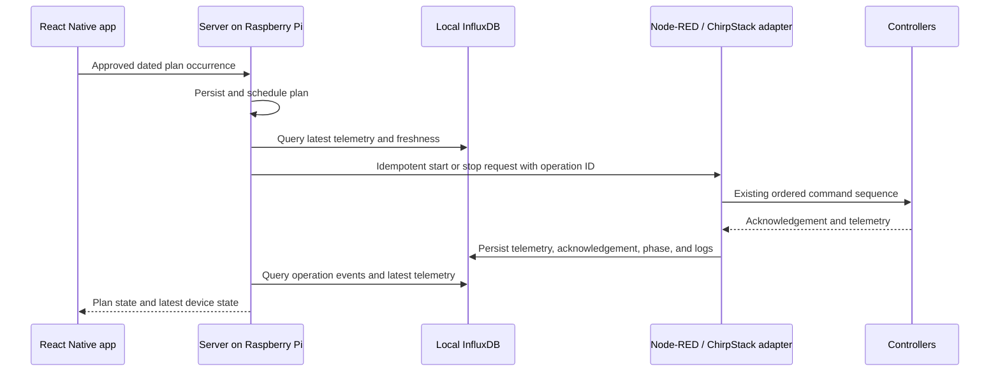

# Phase 6 — local server implementation plan

Detailed, implementation-ready plan for the permanent irrigation server on the
Raspberry Pi. This is the working plan for Phase 6 of
[`AI_WATERING_PLAN_ROADMAP.md`](AI_WATERING_PLAN_ROADMAP.md).

## Status

- Phase 5 exists only as a temporary Node-RED API: store, read, and cancel.
  It does **not** schedule or execute watering.
- Phase 6 is **not implemented yet**. This document is the approved design to
  implement.
- Phase 0 preflight completed on 2026-10-17: 3.0 GB free, backups verified,
  clock synchronized, scoped InfluxDB tokens and both Phase 6 buckets in place,
  and the Python venv ready. Measurements are in
  [`../../deployment/RASPBERRY_PI_SITE_PROFILE.md`](../../deployment/RASPBERRY_PI_SITE_PROFILE.md).
  P1 can start.
- Node-RED dashboard, manual controls, and the temporary API stay running
  throughout Phase 6 and after acceptance. No flow removal is part of this
  work.
- Real-device watering execution is in scope. Acceptance requires supervised
  hardware runs.

## Target architecture



Rules:

- The server never talks to ChirpStack or MQTT directly.
- SQLite is authoritative for plans, revisions, attempts, and lifecycle.
- InfluxDB is the telemetry and operation-event source, not the plan store.
- Node-RED remains the sole owner of the ordered hardware sequence and the
  ChirpStack downlink path.
- Mobile and server UI use the same `/api/v1` business logic.

## Host profile

Measured 2026-10-17: Raspberry Pi 4 Model B, 8 GB RAM, Debian 13 trixie,
aarch64, 16 GB microSD, Node-RED 5.0.4, InfluxDB 2.9.1, ChirpStack 4.18.0,
Mosquitto 2.0.21, Redis 8.0.2, PostgreSQL 17.

Full snapshot and constraints:
[`../../deployment/RASPBERRY_PI_SITE_PROFILE.md`](../../deployment/RASPBERRY_PI_SITE_PROFILE.md).

Critical facts:

- Root filesystem was 98% full (~300 MB free). Disk cleanup is a P0 blocker.
- Time source: `systemd-timesyncd`; `NTPSynchronized=yes`; no chrony.
- No USB SSD. Risk accepted with mitigations (see Decisions).
- Chromium kiosk uses ~1.9 GB RSS. It is not removed in Phase 6.

## Stack

**Python 3.13 + FastAPI + Uvicorn, single process, one worker.**

| Concern | Choice | License | Why |
|---|---|---|---|
| HTTP/API | FastAPI + Uvicorn | MIT / BSD | Typed readable routes, OpenAPI, low memory |
| Validation | Pydantic v2 | MIT | Mirrors the v1 plan schema |
| Persistence | stdlib `sqlite3`, WAL, `BEGIN IMMEDIATE` | PSF | No ORM/driver; reuse proven semantics |
| Influx access | `influxdb-client` | Apache-2.0 | Official v2 client, Flux queries |
| Adapter HTTP | `httpx` | BSD | Bounded-timeout idempotent calls |
| Server UI | Jinja2 + HTMX + plain CSS | BSD / MIT | No Node build step, small footprint |
| Scheduler | `threading.Thread` + stop event | PSF | One dependency-free loop |
| Tests | `pytest`, FastAPI `TestClient` | MIT | Reuse conformance scenarios |
| Logging | stdlib `logging`, rotating handler | PSF | No external service |

Deliberately not used: ORM, Alembic, Redis, PostgreSQL, APScheduler, Celery,
Docker, Node build tooling. Redis/Postgres exist on the host but add nothing at
this scale. Reconsider only with measured need.

Non-negotiable: `uvicorn --workers 1`. Multiple workers would each run a
scheduler. The systemd unit pins one process.

## Repository layout

```text
server/
  pyproject.toml
  irrigation_server/
    app.py                 # FastAPI factory + lifespan
    config.py              # env settings; no secrets in code
    api/routes.py          # /api/v1 mobile + dashboard endpoints
    domain/contract.py     # validation, canonical digest, revision rules
    domain/lifecycle.py    # state machine, gates, recovery
    scheduler.py           # single background tick loop
    store/sqlite.py        # plan/attempt/event transactions
    adapters/node_red.py   # idempotent command + state client
    adapters/influx.py     # telemetry/event queries + freshness
    ui/templates/          # Jinja2 pages
    ui/static/             # CSS + small JS
  migrations/              # copies of sqlite/001, 002 (+ later migrations)
  systemd/irrigation-server.service
  tests/
```

`tools/watering_plan_*.py` remains the reference implementation. Port, do not
import: `tools/` stays Python 3.8-compatible; the server targets the Pi's
Python 3.13.

## Data ownership

| Data | Owner | Store |
|---|---|---|
| Plan definitions, revisions, attempts, lifecycle events | Server | SQLite |
| Device telemetry | Node-RED | InfluxDB `irrigation_telemetry` |
| Operation requests/acks/phases/results | Node-RED adapter | InfluxDB `irrigation_events` |
| Device command sequence | Node-RED `CONTROL` | Flow state |
| Mobile/UI reads | Server | SQLite + InfluxDB |

Influx schema and field mapping:
[`INFLUX_SCHEMA.md`](INFLUX_SCHEMA.md).

Event caveats:

- ACK events exist only for `confirmed:true` downlinks; current commands are
  unconfirmed. Do not treat a missing ACK as failure.
- Device acceptance is proven by the next UP: `reported_command_id` +
  `command_phase` (Main Valve), `last_command_id` + `pcv_last_commanded`
  (valves), `last_command_id` + `command_result` (pump).
- `txack` proves gateway transmission only.
- `flow_total_since_reset_m3 = null` means meter evidence is unavailable.
  Volume plans must be rejected or stopped, never treated as zero.

## Execution path

1. Operator or mobile submits an approved, dated occurrence.
2. Server validates and stores it in SQLite.
3. Scheduler tick claims due plans atomically; only one active plan.
4. Gates: clock synchronized, Influx telemetry fresh, executor idle, valve set
   allowed, runtime accepted, no conflicting active run.
5. Server sends an idempotent `start` with a stable `operation_id` to the
   Node-RED adapter.
6. Node-RED `CONTROL` runs the established sequence:
   MainValve → pump → selected valves.
7. Node-RED writes telemetry, command acknowledgements, sequencer phases, and
   results to InfluxDB under the `operation_id`.
8. Server observes running state from InfluxDB, measures duration from a
   process-monotonic clock, and evaluates volume against the commissioned
   meter baseline.
9. On target reached or cancel, the server sends an idempotent stop.
10. Ordered shutdown runs; `completed` is recorded only after evidence.
11. Restart: active attempts become `recovery_required`; a safe stop may be
    requested; watering never resumes automatically.

Manual coexistence: Node-RED dashboard controls remain active. The adapter must
reject a start when not idle, and the server must not dispatch when the executor
is non-idle. Manual stop is honored and reflected in the plan state.

## Phases

### P0 — Preflight

Blocking.

1. **Free disk (authorized):** remove `/home/maxi/.rustup` (~2.5 GB), prune
   InfluxDB retention, disable `docker.service`/`containerd.service`, run
   `apt clean` and journal vacuum, remove old logs/caches. Target ≥2 GB free.
2. **Backups:** Node-RED flows export and SQLite-consistent plan-store backup;
   record restore procedure.
3. **Influx tokens:** confirm both tokens are scoped to org `amudario` and the
   intended buckets (Node-RED write; server read). Not all-access. Never store
   in git.
4. **Buckets:** create `irrigation_telemetry` (90 days) and
   `irrigation_events` (365 days). Leave `main_valve` untouched.
5. **Clock:** gate on `timedatectl show -p NTPSynchronized --value` = `yes`
   and NTP service active. No offset threshold is claimed.
6. **Python:** create a venv, install pinned dependencies, measure RSS and disk.
7. Record all measurements in the site profile.

Exit: ≥2 GB free, backups verified, tokens and buckets confirmed, venv runs.

### P1 — Backend core and API conformance

1. FastAPI app, typed settings, structured logging, `/api/v1/health`.
2. SQLite store: port accept/get/list/cancel/claim/recover with transactional
   revision rules from `tools/watering_plan_store.py`.
3. `/api/v1` routes with identical paths, envelopes, status codes, error codes,
   and `plan_id`/`revision` idempotency.
4. Run `tools/test_watering_plan_backend.py` against the server; it is the
   contract.
5. Capability configuration: gateway runtime cap, field registry, allowed valve
   sets, units.

Exit: conformance suite green. No Node-RED behavior changed.

### P2 — Influx provider and adapter contract

1. `adapters/influx.py`: latest state per device, `observed_at`, freshness,
   explicit `stale`/`unavailable`.
2. `GET /api/v1/device-state` served from InfluxDB.
3. Adapter contract: idempotent `start`/`stop`, stable `operation_id`, bounded
   timeout, duplicate handling, error mapping.
4. Additive Node-RED nodes write `device_telemetry`, `operation_event`,
   `command_ack`, `sequencer_phase` using the installed
   `node-red-contrib-influxdb` 0.7.0. Do not remove or rewrite dashboard nodes.
5. Adapter idempotency: retries must not repeat actuation. Document whether
   dedup is durable or process-local; close any gap before execution.
6. Keep `/internal/irrigation/state` for fast gating; results come from
   InfluxDB, not inferred from the state endpoint.

Exit: fake Influx/adapter tests pass; a live test writes and queries an
operation timeline.

### P3 — Scheduler and real-device execution

1. One tick loop (1 s): expire → reconcile → claim → gate → dispatch → record.
2. Priority order and conflict handling; one active attempt.
3. Duration stop using monotonic time from confirmed running.
4. Volume stop only with fresh commissioned meter evidence.
5. Active cancel → `stop_requested`; physical stop only with evidence.
6. Startup recovery; no resume; no blind start retry.
7. Manual-control interlock.
8. Real-device supervised run through the full path.

Exit: ported scheduler tests pass; fake-hardware end-to-end passes; supervised
real-device run passes.

### P4 — Server UI dashboard

1. Jinja2 pages with Integrated-page parity: settings, valve selection,
   start/stop, request stop, device cards with freshness, Upcoming/Active/Recent
   plans, safety limits.
2. Same API as mobile; no duplicated business logic.
3. Polling only: state ~2 s, plans ~15 s. No websockets/SSE for control state.
4. Signed HttpOnly `SameSite=Strict` cookie login; env-provided operator
   credential and session secret; CSRF on actions; login rate limiting; `Secure`
   cookie under TLS; per-user auth later.
5. Explicit stale/unavailable display; never show cached data as live.

Exit: operator completes a supervised cycle from the server UI.

### P5 — Parallel operation and acceptance

1. Run the server on a separate port; switch the mobile profile only for tests.
2. Keep Node-RED dashboard and temporary API running unchanged.
3. Use distinct test plan IDs; no bulk migration until acceptance.
4. Single execution-owner interlock; operator-visible owner indicator.
5. Run live API, idempotency, restart, cancellation, and real-device tests.
6. Acceptance = server passes all tests while Node-RED remains unchanged.
7. Rollback = stop server service, switch mobile profile back to Node-RED.

Any Node-RED slimming or removal is a separate, explicitly approved task after
an observation period. It is out of scope for Phase 6.

### P6 — Hardware commissioning sign-off

Record evidence for:

- duration completion and ordered shutdown;
- volume completion against the commissioned meter;
- active-stop acknowledgement vs physical stop;
- Pi restart during idle and during a run;
- radio loss and meter loss;
- unsynchronized clock rejection;
- duplicate delivery and timeout retry;
- delayed plan and expiry;
- pump/valve conflict and manual/scheduler coexistence.

No production watering until all items pass.

## Safety invariants

- Plan acceptance never means watering started.
- `stop_requested` is not a physical stop.
- No auto-resume after restart.
- One scheduler process, one active plan, one execution owner.
- Server never emits device commands directly.
- Plans in SQLite; telemetry and operation events in InfluxDB.
- Reject plans when clock or required telemetry evidence is unavailable.
- Tokens never appear in flow JSON, UI, logs, screenshots, or git.
- Existing Node-RED flows stay intact throughout Phase 6.

## Environment variables (no secret values here)

Server:

- `IRRIGATION_DATABASE_PATH`
- `IRRIGATION_INFLUX_URL`, `IRRIGATION_INFLUX_ORG`, `IRRIGATION_INFLUX_BUCKET_TELEMETRY`, `IRRIGATION_INFLUX_BUCKET_EVENTS`, `IRRIGATION_INFLUX_TOKEN` (read)
- `IRRIGATION_NODE_RED_BASE_URL`, `IRRIGATION_INTERNAL_TOKEN`
- `IRRIGATION_PLAN_API_TOKEN` (mobile bearer)
- `IRRIGATION_SESSION_SECRET`, `IRRIGATION_OPERATOR_PASSWORD` (UI)
- `IRRIGATION_GATEWAY_MAX_RUNTIME_SEC`, `IRRIGATION_FIELD_REGISTRY`, `IRRIGATION_ALLOWED_VALVE_SETS`, `IRRIGATION_DURATION_UNITS`, `IRRIGATION_VOLUME_UNITS`
- `IRRIGATION_SITE_ID`

Node-RED:

- `IRRIGATION_INFLUX_TOKEN` (write) stored in the InfluxDB config-node credentials, not flow JSON
- existing `IRRIGATION_INTERNAL_TOKEN`
- existing field registry, allowed valve sets, meter status

## Verification

```sh
# Server unit and conformance tests
pytest server/tests
python3 tools/test_watering_plan_backend.py

# Reference and generated-flow regressions
PYTHONPATH=tools python -m unittest \
  test_watering_plan_api test_watering_plan_store test_watering_plan_scheduler -v
node tools/test_watering_plan_contract.js
node tools/test_irrigation_dashboard.js
node tools/test_nodered_flows.js
node tools/test_flow_ids.js
npm test --prefix nodes/watering-plan-store

# Live, authorized test Pi only
export IRRIGATION_PLAN_API_URL='https://<test-pi>'
export IRRIGATION_PLAN_API_TOKEN='<test-token>'
python3 tools/test_mobile_watering_plan_api.py --live --timeout 15
```

Measure and record after each phase: free disk, server RSS, Node-RED RSS,
Influx query latency, tick duration. Report mock, reference, generated-flow, and
live-Pi results separately.

## Decisions recorded

| Topic | Decision |
|---|---|
| Language/framework | Python 3.13 + FastAPI + Uvicorn |
| Persistence | SQLite, stdlib `sqlite3` |
| Cache | In-process TTL only; no Redis |
| UI | Jinja2 + HTMX, polling |
| UI auth | Signed HttpOnly cookie login |
| Influx writes | Node-RED, additive; server reads |
| Real execution | In scope in Phase 6 |
| Node-RED removal | Not in Phase 6; parallel operation only |
| Storage | No SSD; free microSD space and accept risk with mitigations |
| Clock | `systemd-timesyncd`, boolean `NTPSynchronized` gate |

## Open items before coding starts

1. Confirm both InfluxDB tokens are bucket-scoped as intended.
2. Free disk space and record the result.
3. Confirm the deployed Node-RED flow matches the repo builder; if not, provide
   the relevant tabs.
4. Confirm live `SETTINGS` values match the builder defaults (no site overrides).
5. Decide server LAN port, TLS/reverse-proxy plan, and systemd user/paths.
6. Define the mobile app's server-token provisioning once the server exists.
7. Define parallel-run data policy: start empty vs import plan IDs (default:
   empty store, test IDs only).
8. Schedule supervised hardware test windows and name the operator.

## Assumptions

- ChirpStack MQTT payloads match the 2026-10-17 capture; codec objects are
  enabled.
- Node-RED remains the only device-command owner for the duration of Phase 6.
- The Pi can run FastAPI, Node-RED, InfluxDB, Mosquitto, and ChirpStack within
  8 GB RAM after the desktop/kiosk is considered; server RSS is expected to be
  well below 150 MB.
- InfluxDB retention and write volume stay modest at the planned cadence.

If any assumption changes, update this document before implementation.
